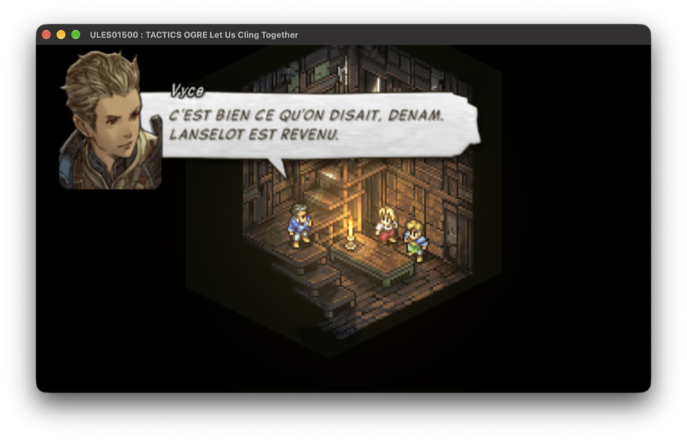
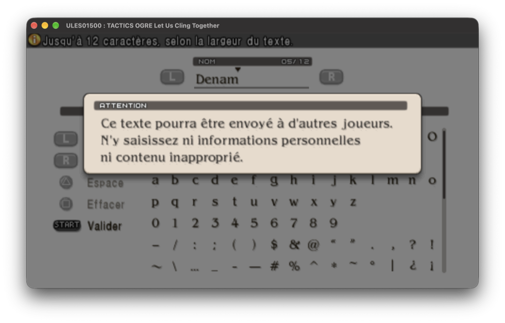

# Tactics Ogre: Let Us Cling Together (PSP) — traduction française

Traduction française non officielle du remake PSP de *Tactics Ogre: Let Us Cling Together* (version européenne **ULES01500**), avec les outils qui ont servi à extraire et réinjecter le texte.

<p align="center">
  
  
</p>

> Ce projet ne contient aucune donnée du jeu. Il vous faut votre propre copie (ISO) de la version européenne.

## Installation (joueurs)

1. Procurez-vous l'ISO européenne d'origine : `Tactics Ogre - Let Us Cling Together (Europe).iso`, MD5 `117128cc924f8f42a88d775ce2b809e8`.
2. Téléchargez le patch depuis la [dernière release](https://github.com/Gabin-CC/tactics-ogre-psp-fr/releases/latest) (ou [`patch/`](patch/)) et appliquez-le :
   - Windows : [Delta Patcher](https://github.com/marco-calautti/DeltaPatcher) ou xdeltaUI ;
   - macOS / Linux : `xdelta3 -d -s "ISO originale.iso" Tactics_Ogre_PSP_FR.xdelta "Tactics Ogre (FR).iso"`.
3. Jouez sur PPSSPP ou sur une PSP avec firmware personnalisé.

N'utilisez pas l'option **Data Install** du menu titre : les données installées sont celles d'origine, en anglais.

## Ce qui est traduit

- Tous les dialogues de l'histoire, y compris l'épilogue et les scènes additionnelles.
- Menus, commandes, aides, messages système et de combat.
- Objets, armes, sorts, compétences, classes et leurs descriptions.
- Le Rapport de Warren : biographies, chronique, gazette, musique, guides.
- Incantations, dernières paroles, répliques d'unités, textes défilants.

Cela représente environ 15 000 chaînes, soit environ 219 000 mots anglais. Les noms propres et les crédits sont conservés.

**Non traduit**, car il s'agit d'images ou de vidéos :
- le menu titre ;
- les questions du tarot au début du jeu ;
- les grands titres de chapitres ;
- les sous-titres incrustés dans les cinématiques ;
- quelques étiquettes graphiques de l'interface.

## Corriger ou améliorer la traduction

Les textes sont dans [`traduction/final.json`](traduction/final.json), sous la forme `identifiant → texte français`. Conventions et glossaire : [`traduction/GUIDE.md`](traduction/GUIDE.md), [`traduction/glossary.json`](traduction/glossary.json).

Règles à respecter :
- Gardez intactes les balises `{…}` : `{np}` nouvelle bulle, `{pp}` nouvelle page, `{hero}` nom du héros, `{FF ..}` codes de contrôle.
- Une bulle de dialogue affiche au plus **3 lignes** d'environ 45 caractères.
- Les en-têtes entièrement en majuscules s'écrivent **sans accents** : leur police n'en contient pas.

Reconstruire une ISO (Python 3 requis, sans dépendance) :

```sh
./reconstruire.sh "Tactics Ogre - Let Us Cling Together (Europe).iso" "Tactics Ogre (FR).iso"
```

Pour retrouver le texte anglais d'un identifiant, générez la liste des chaînes depuis votre ISO :

```sh
python3 outils/extract_usrdir.py jeu.iso /tmp/usrdir
python3 outils/export.py /tmp/usrdir /tmp/   # crée /tmp/units.json (k, src, contexte)
```

## Les outils

| Fichier | Rôle |
|---|---|
| `filetable.py` | lecture/écriture de `FILETABLE.BIN` (table des fichiers) |
| `pakd.py` | archives `pakd` |
| `tree.py` | arborescence des fichiers + messages d'événements `EMES` |
| `xlc.py` | tables compilées `xlce` (détection des colonnes de chaînes) |
| `codec.py` | encodage du texte (police EN, accents, balises) |
| `span.py`, `font.py` | recalcul des en-têtes de texte (largeur via métriques et crénage de la police) |
| `layout.py`, `check.py` | simulation des bulles de dialogue, vérification d'une traduction |
| `build.py`, `isopatch.py`, `apply.py` | reconstruction des BIN, de la table et de l'ISO |

## Crédits

- Formats de fichiers documentés grâce à [Gibbed.LetUsClingTogether](https://github.com/gibbed/Gibbed.LetUsClingTogether) (Rick « gibbed », licence zlib). La table de caractères `charmap_en.json` est dérivée de sa documentation.
- Traduction réalisée avec l'aide de Claude (Anthropic).
- *Tactics Ogre* © 1995, 2010, 2011 Square Enix. Projet de fans non affilié, sans but commercial.

## Licence

Le code des outils est sous licence MIT (voir [`LICENSE`](LICENSE)). Les textes de traduction sont fournis pour un usage non commercial avec le jeu original.
